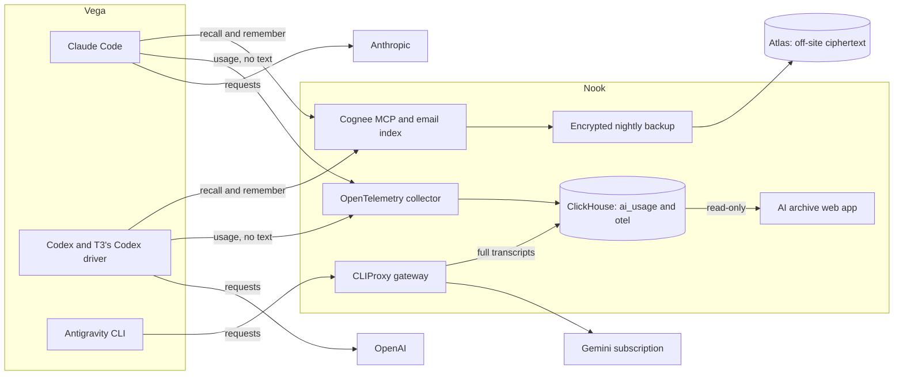

# Coding agents

Lisa's coding agents are declared in Home Manager. One instruction file, one
skill set, one MCP catalog and one permission setup are each written once and
rendered into every client's own format. `checks.agent-policy` fails when a
rendered configuration drifts from those sources. [Decisions](decisions.md)
records why each part is the way it is.

## Clients by host

| Client | Hosts | Module | Model route |
| --- | --- | --- | --- |
| Claude Code | Vega, Asterion, Nook (Lisa) | `modules/development/claude-code.nix` | Anthropic, direct |
| Codex CLI and desktop app | Vega, Asterion, Nook (Lisa) | `modules/development/codex/` | OpenAI, direct |
| Codex remote control | Nook (`codex` account, disabled until its login is renewed) | `modules/development/codex/nook.nix` | OpenAI, direct |
| T3 Code (Codex, Claude, Antigravity drivers) | Vega | `modules/development/t3-code/` | Each driver's own route |
| Antigravity CLI (`agy`) | Vega | `modules/development/antigravity.nix` | Nook gateway |
| Zed agent | Vega, Asterion | `modules/development/zed/` | Codex subscription; OpenRouter for commit messages |
| GitHub Copilot CLI | Instructions and skills only | `modules/development/ai-skills/default.nix` | GitHub |

Which of these routes the gateway captures is in
[the AI gateway guide](ai-usage.md#what-is-captured).

## Where data goes



Claude and Codex transcripts stay in their local session files; only usage
reaches Nook. Cognee's own model calls also go through the gateway.

## Instructions and skills

Everything in this section is the exported Home Manager module
`modules.homeManager.ai-environment`; `checks.agent-policy` evaluates it in a
home with nothing else of Lisa's, so another flake can import it on its own.

`modules/development/ai-skills/AGENTS.md` is the global instruction file. Home
Manager writes it as `~/.claude/CLAUDE.md`, `~/.codex/AGENTS.md`,
`~/.gemini/GEMINI.md` (Antigravity) and Copilot's instructions. This repository's
own rules for agents are in the root [AGENTS.md](../AGENTS.md).

Counts and MCP loading on Vega, rendered from Nix; `checks.agent-policy` fails
when this block no longer matches and prints the current version. [Skills](skills.md)
lists every skill with its clients and what it does, generated the same way.

<!-- catalogue:start: rendered from Nix; checks.agent-policy prints the current version when this differs -->
| Skills on Vega | Claude | Codex | Antigravity | Copilot |
| --- | ---: | ---: | ---: | ---: |
| Installed | 64 | 65 | 11 | 11 |
| Of which pstack, manual only | 49 | 49 | 0 | 0 |

| MCP server | Claude | Codex |
| --- | --- | --- |
| clerk_mcp | tool search | tool search |
| cognee | tool search | tool search |
| nixos | tool search | tool search |
| rea | tool search | tool search |
| webmcp | tool search | tool search |
<!-- catalogue:end -->

| Skill set | Source | Claude | Codex | Antigravity, Copilot |
| --- | --- | --- | --- | --- |
| Bundled skills | `ai-skills/skills/` | yes | yes | yes |
| tstack (`council`, `full-send`, `full-stop`, `sol-loop`) | pinned GitHub revision | yes | yes | no |
| pstack | vendored, provenance in `ai-skills/pstack/IMPORT.md` | yes, manual only | yes, manual only | no |
| REA's `reverse-engineer-anything` | REA package | no | yes | no |

All 49 pstack skills set `allow_implicit_invocation: false` in
`agents/openai.yaml`, so Codex never loads them on its own. Claude reads the same
policy from frontmatter, so its copies gain `disable-model-invocation: true` at
build time: they run only when named and add nothing to the model's context.
`checks.agent-policy` validates every bundled and pstack `SKILL.md`: its
frontmatter, a name equal to its directory, a description within the
1,024-character limit, and the reference files it names. It also fails when two
sets ship a skill with the same name, which would silently replace one with the
other. [Skills](skills.md#context-budget) estimates what the skill index costs
each session.

## MCP servers

`modules/development/mcp.nix` declares the shared servers once: Cognee (personal
memory, OAuth through Authentik; Nook's Codex service gets it too), Clerk,
`mcp-nixos` (NixOS, Home Manager and nix-darwin package and option lookup),
webmcp (a Nix-packaged bundle, so nothing is fetched from npm at run time), and
REA from `modules/development/rea.nix`. The catalogue above shows how each
client loads them. No MCP tool asks for approval, and `checks.agent-policy`
fails if one is set to. Every stdio server must run from the Nix store: the
check rejects package runners such as `npx` or `uvx`.

Neither client loads MCP tool schemas up front. Claude Code runs with
`ENABLE_TOOL_SEARCH=true`, and Codex marks every server
`omit_tools_from = ["direct"]`; both find a server's tools through tool search
when a task needs them. `checks.agent-policy` and `checks.rea-codex-config` fail
if either setting goes away.

What that saves, measured on Vega on 2026-11-23:

| Measurement | Size |
| --- | --- |
| REA's 229 tool schemas, from its `tools/list` result | about 3.8 MB, roughly 950,000 tokens |
| Claude's first request in a session, median of 89 sessions over 7 days | 46,446 tokens (33,835 to 80,367) |
| Codex's first request in a session, median of 22 sessions over 7 days | 28,233 tokens (22,448 to 32,109) |

The first request carries the system prompt, instructions, skill descriptions
and every tool schema loaded up front, so it is what each new session costs
before any work. Run `agent-context-baseline` (optionally `--days N`) to measure
it again from the session files both clients keep; it reads only token counts.
The Codex figure predates deferring Clerk, Cognee and webmcp; REA was already
deferred.
Both clients get the same servers; `checks.agent-policy` fails if the sets diverge.
Repository `.mcp.json` servers do not start in Claude unless enabled
(`enableAllProjectMcpServers = false`), so a cloned repository cannot add servers
on its own.

## Permissions

Lisa runs every agent with full access, by choice since 2026-11-23: no sandbox
and no approval prompts. `modules/development/agent-policy.nix` sets this in
each client's own format, and `checks.agent-policy` fails if a client starts to
sandbox or ask again.

| Client | Setting |
| --- | --- |
| Claude Code | `permissions.defaultMode = "bypassPermissions"`, no ask rules, no hooks, no bypass warning |
| Codex | `sandbox_mode = "danger-full-access"`, `approval_policy = "never"`, no rules or hooks |
| Zed | every tool allowed, unsandboxed |
| Antigravity CLI | no ask rules, access outside the workspace allowed |
| MCP servers | no approval prompts in either client |

Two limits remain, neither of which asks anything:

- **Credentials.** Claude's Read tool cannot open SSH private keys, the age
  identity, Codex's login, the gateway client key or `/run/agenix`.
- **Nesting.** `CLAUDE_CODE_MAX_SUBAGENT_SPAWN_DEPTH=1` keeps subagents from
  starting their own, AGENTS.md's no-nested-delegation rule.

AGENTS.md still tells agents to get Lisa's explicit approval in chat before
deploying, switching a daily driver, deleting memory or writing to an outside
service; nothing in the clients enforces it.

Claude's own auto memory is off, as Codex's memories are: Cognee holds memory
across sessions, and AGENTS.md says when to use it. Neither client checks for
its own updates; Nix installs both.

## What this does not protect against

With full access, nothing stands between an agent and Lisa's account except
its instructions:

- **Any command runs.** Deploys, switches, `git push`, deletions and
  third-party writes run without a prompt, in every client.
- **Shell reads.** Claude's Read deny rules stop only its Read tool; a shell
  command such as `cat ~/.config/sops/age/keys.txt` still works, in Claude and in
  Codex.
- **Network.** Every client keeps network access, so a prompt injection that gets
  a command to run can send what that command can read.

## Mutable settings

Claude Code, Codex and Antigravity use `mutableSettings`. Activation merges the
declared values into the writable files, so declared keys win, and settings an
app writes for itself survive (for example, the Codex app's own `node_repl` and
`computer-use` servers). The merge itself never removes a key, so a later step,
`codexRetireSettings`, keeps a manifest per file of the keys Nix declared at the
last activation, in `~/.local/state/forge-agent-policy/`, and deletes the ones
Nix no longer declares from `~/.codex/config.toml`, `~/.claude/settings.json` and
Antigravity's `settings.json`. That is how the old gateway provider
`model_providers.nook` and Claude's former `CLAUDE_CODE_SUBPROCESS_ENV_SCRUB` left
the live files. Keys the app or Lisa added were never in a manifest and stay.

`checks.agent-policy` runs Home Manager's real merge and retirement steps for the
system's own home against a stale home (the earlier sandbox, ask rules and hook,
an `npx` server, the retired gateway provider, an app-owned key and server) and
requires the full-access settings to win, the old rules and provider to go, and
the app-owned entries to stay.

Because those files stay writable, every activation then runs
`agent-policy-status`, which compares the live `~/.codex/config.toml` and
`~/.claude/settings.json` with the policy and warns about each difference: the
Codex sandbox and approval mode, Claude's permission mode, or a missing
credential deny rule. Run `agent-policy-status` at any time for the same report.

## Telemetry

Claude Code and Codex send usage telemetry, without prompt or response text, to
Nook's collector ([AI gateway](ai-usage.md#usage-telemetry)).

## Verification

```sh
nix build .#checks.aarch64-darwin.agent-policy
nix build '.#homeConfigurations."lisa@vega".activationPackage' --no-link
```

The first command checks the policy, MCP catalog, tool deferral, telemetry
privacy and instruction delivery for all three of Lisa's homes and Nook's Codex
service, runs the real settings merge against a stale home, tests the drift
report and the key retirement, and validates every skill. The second builds Vega's home
without activating it.
